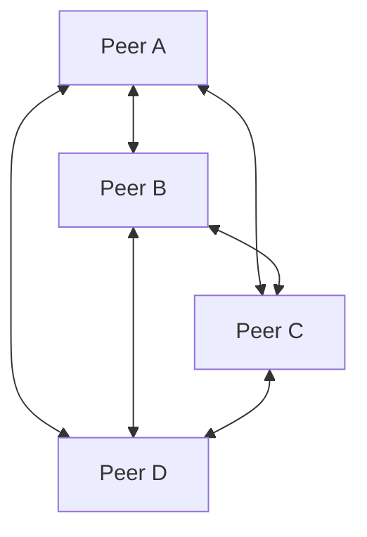
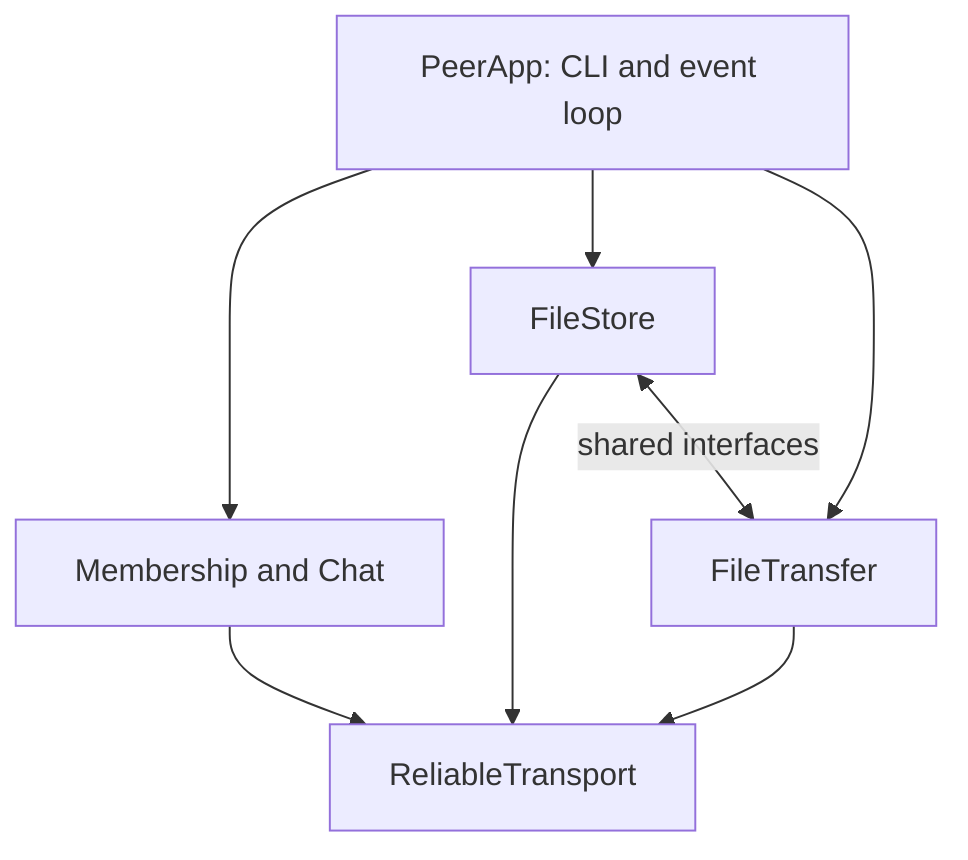
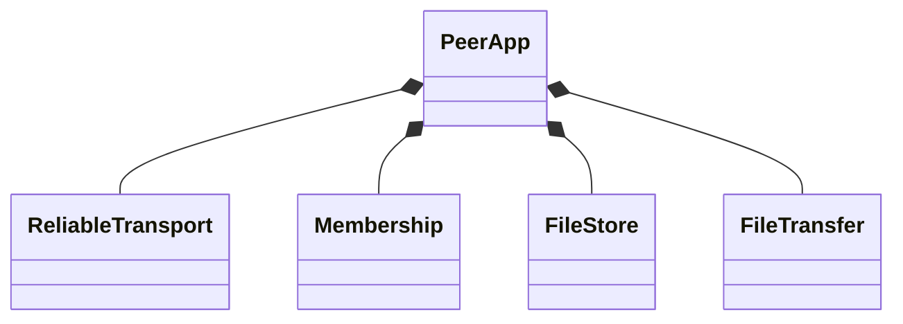

# Proposed architecture

Every computer runs the **same** peer application. Roles describe who writes a module, not which computer hosts it. A reachable existing peer bootstraps newcomers; it is not a central server.

All links carry direct UDP application messages. LAN access points/switches only carry traffic. Test four processes with ports 5001–5004 and distinct data folders, then four computers.

## Inside one process

Only ReliableTransport reads the UDP socket. PeerApp services nonblocking input, transport and timers, then dispatches validated messages. Control/chat and file streams must both progress.

## Proposed class and interface ownership

These are design contracts to implement under I02, not classes already completed in the skeleton.

| Service | Implements | Depends on | Owner |
|---|---|---|---|
| ReliableTransport | ITransport | UdpSocket, PacketCodec, ReliableChannel | M1 |
| Membership | IPeerDirectory | ITransport | M2 |
| ChatService | — | ITransport, IPeerDirectory | M2 |
| FileStore | IChunkStore | ITransport, IPeerDirectory, IChunkFetcher | M3 |
| FileTransfer | IChunkFetcher | ITransport, IPeerDirectory, IChunkStore | M4 |
| PeerApp | — | Creates and connects all concrete services | M2 |

Interfaces have virtual destructors. Agree asynchronous callbacks, ownership/lifetime, cancellation, failure and queue-full semantics before implementing. Libraries depend on interface declarations in common rather than constructing other concrete services.

## Packet stories

**Join:** B sends JOIN to A. A replies WELCOME with a peer-list snapshot and echoed nonce. B establishes session identities, sends HELLO to known peers, repairs missing membership pages, then receives catalog/manifest information and its storage share. Repeated packets must be safe.

**Chat:** A's chat service obtains the active remote peers and sends a copy to B, C and D. M1 tracks ACKs/retries independently for each destination. If C's ACK is lost, C ACKs the retry but does not display twice. Delivery order is per sender/session, not globally across senders.

**Share:** M3 splits a file, hashes it, chooses holders and asks M4 to move chunks through M1. A holder is advertised only after hash verification and successful storage confirmation. A packet ACK alone does not prove storage.

**Download:** M4 fetches distinct chunks concurrently from at least two remote confirmed holders. It preserves verified progress, switches unfinished work to a surviving replica, writes the correct output offsets, and checks the final hash. If all copies of a needed chunk disappear, report failure.

## Storage constraints

A 2 MiB file contains 128 chunks at 16 KiB. Each managed chunk has two distinct confirmed holders after initial distribution; no one peer has all managed chunks. Originals and requested outputs are separate and must never be deleted automatically. Confirm the instructor's interpretation of temporary seeding copies.

Sort active peer IDs. For chunk c choose positions (offset+c) mod N and (offset+c+1) mod N. For N >= 3 and at least three chunks this avoids a complete managed copy; validate it for all supported inputs. Desired placement is not evidence of actual holders. Keep old verified replicas until replacement storage is confirmed.

A source crash can leave one replica: required download failover uses that survivor. Rebuilding two replicas is optional I44. Two live peers cannot simultaneously satisfy two replicas per chunk and no complete managed copy.

## Scope

Required: four peers, two files >= 2 MiB per member, eight files total, dynamic fifth-peer join, bootstrap independence, reliable ordered chat, replicated metadata, parallel downloads, failover and integrity verification.

Initial platform: Linux, C++17, POSIX UDP, CMake, CLI, single nonblocking event loop. GUI, multicast discovery, private chat, encryption and replica repair are later work. CRC/SHA-256 detect corruption, not peer authentication. This is a controlled LAN prototype; general Internet deployment requires additional design.
